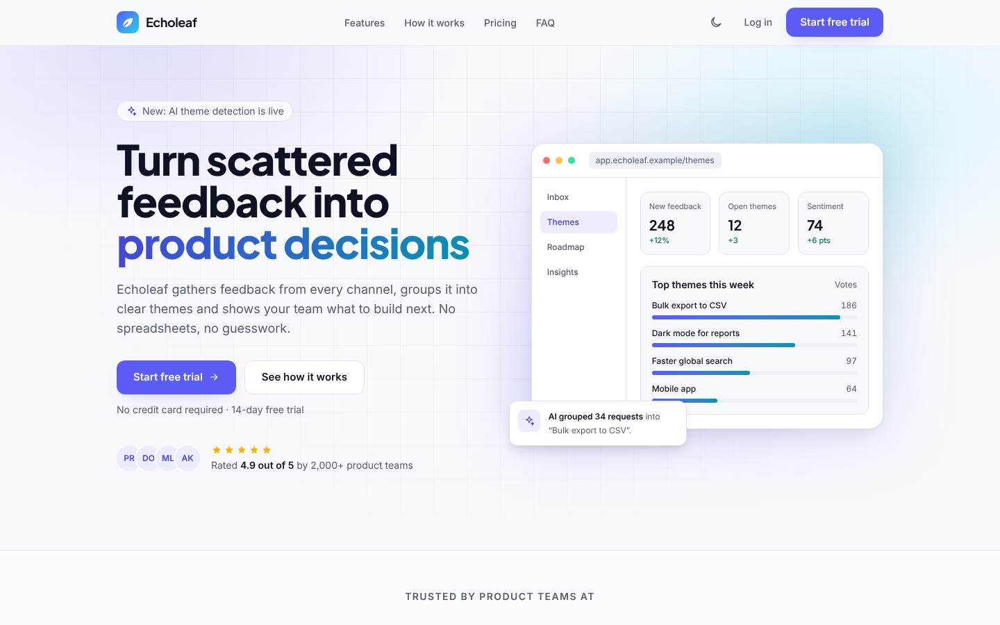
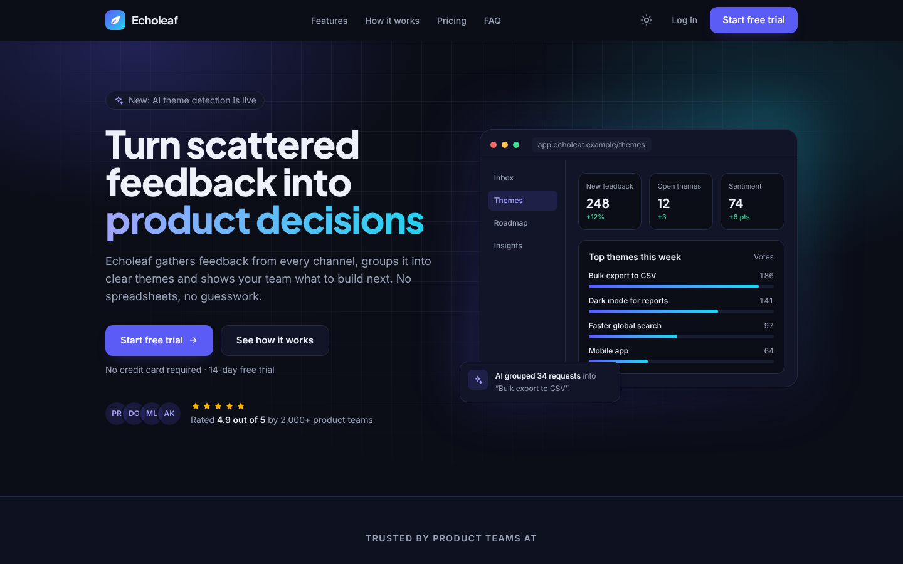
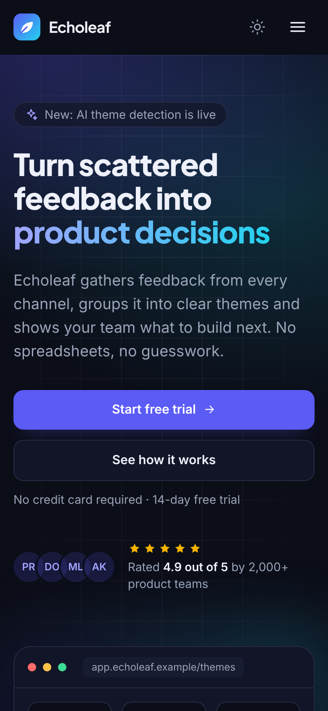

# Echoleaf: SaaS Landing Page

A fast, accessible landing page for **Echoleaf**, a fictional customer-feedback SaaS product.
Built with React, Vite and Tailwind CSS v4, and deployed on Netlify.

> **Note:** This is a sample website for portfolio and demonstration purposes.
> Echoleaf and every company, person and quote on the page are fictional.

**Live demo:** https://echoleaf-demo.netlify.app




<p align="center">
  
</p>

---

## Features

- **Conversion-focused layout:** hero, logo strip with animated stats, feature grid, alternating detail
  blocks, three-step "How it works", pricing, testimonials, FAQ, final call to action and signup.
- **Interactive pricing:** monthly/yearly switch with a discount badge. All plan data lives in one file.
- **Accessible by design:** semantic landmarks, skip link, a real `role="switch"` billing toggle,
  an ARIA accordion, visible focus states, WCAG AA color contrast and full keyboard support.
- **Light and dark themes:** follows the system preference, remembers the user's choice and never
  flashes the wrong theme on load.
- **Motion with care:** scroll reveals and number counters are disabled for `prefers-reduced-motion`.
- **Netlify Forms signup:** AJAX submission, client-side validation, honeypot spam protection and an
  inline success message.
- **SEO ready:** meta description, canonical URL, Open Graph and Twitter tags, sitemap, robots.txt,
  SVG favicon and a custom 404 page.
- **Lightweight:** no UI libraries, no images to download (all visuals are HTML, CSS and inline SVG),
  and self-hosted variable fonts.

## Tech stack

| Area      | Choice                                                 |
| --------- | ------------------------------------------------------ |
| Framework | React 19                                               |
| Build     | Vite 7                                                 |
| Styling   | Tailwind CSS v4 with CSS-variable design tokens        |
| Fonts     | Plus Jakarta Sans and Inter (self-hosted, Fontsource)  |
| Forms     | Netlify Forms                                          |
| Hosting   | Netlify                                                |

## Getting started

Requirements: Node.js 20.19 or newer.

```bash
npm install
npm run dev       # start the dev server at http://localhost:5173
npm run build     # build for production into dist/
npm run preview   # serve the production build locally
```

The signup form only works on Netlify. Locally, submitting it shows the error message, which is expected.

## Customization

| What                        | Where                                                        |
| --------------------------- | ------------------------------------------------------------ |
| Prices, plans and features  | `src/data/pricing.js`                                        |
| All other page copy         | `src/data/content.js`                                        |
| Colors, radii and shadows   | Token blocks at the top of `src/index.css`                   |
| Site URL                    | `index.html` (canonical, og:url, og:image), `public/robots.txt`, `public/sitemap.xml` |

### Social preview image

Social networks need a PNG preview, so `public/og-image.png` (1200 × 630) is exported from
`public/og-image.svg`. If you change the SVG, export it again with any SVG-to-PNG converter, or open the
SVG in Chrome and take a node screenshot from DevTools.

## Deployment (Netlify)

1. Push the project to a GitHub repository.
2. In Netlify, choose **Add new project → Import an existing project → GitHub**, then pick the repository.
3. Netlify reads the build settings from `netlify.toml` (`npm run build`, publish `dist`).
4. Enable **Forms → form detection** in the project settings, then redeploy.
5. Optionally rename the site and update the site URL in the files listed above.

No `_redirects` file is needed: this is a single page, and Netlify serves `dist/404.html` for unknown URLs.

## Project structure

```
├── docs/                Screenshots used in this README
├── public/              Static files copied as-is (favicon, OG image, robots, sitemap)
├── src/
│   ├── components/
│   │   ├── layout/      Header and footer
│   │   ├── mockups/     HTML/CSS product illustrations
│   │   ├── sections/    One component per landing page section
│   │   └── ui/          Small reusable pieces (icon, logo, reveal, counter, ...)
│   ├── data/            Page copy and pricing data
│   ├── hooks/           Theme, in-view and count-up hooks
│   ├── pages/           404 page content
│   ├── App.jsx          Section order
│   ├── index.css        Design tokens and global styles
│   ├── main.jsx         Landing page entry
│   └── not-found.jsx    404 page entry
├── 404.html             Static 404 entry
├── index.html           Landing page entry, SEO tags, Netlify form definition
├── netlify.toml         Build and header settings
└── vite.config.js       Vite, React and Tailwind setup
```

## Lighthouse scores

Target: 90+ in every category (mobile, tested on the deployed URL).

| Performance | Accessibility | Best Practices | SEO |
| ----------- | ------------- | -------------- | --- |
| _TBD_       | _TBD_         | _TBD_          | _TBD_ |

<!-- After testing, save the report screenshot as docs/lighthouse.png and uncomment the line below. -->
<!--  -->

To measure: open the live site in a Chrome Incognito window, open DevTools (F12), go to the **Lighthouse**
tab, select **Mobile** and all four categories, then click **Analyze page load**.
You can also use [PageSpeed Insights](https://pagespeed.web.dev/).

## Credits

All icons, illustrations and logos are original and drawn as inline SVG for this project.
Fonts: Plus Jakarta Sans and Inter, both under the SIL Open Font License.

## License

MIT. Feel free to use this project as a reference.
